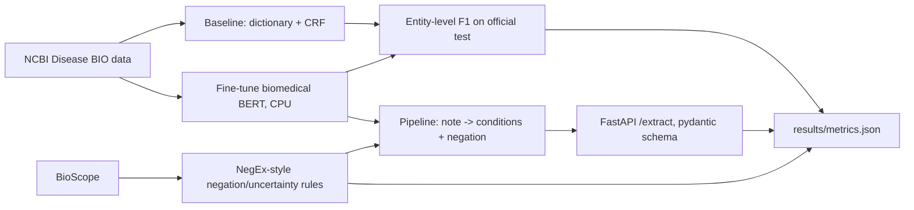

# Clinical NLP extraction

Fine-tunes a biomedical transformer to pull disease mentions out of PubMed abstracts, compares it with a dictionary-plus-CRF baseline on the official NCBI Disease test split, labels negation and uncertainty with NegEx-style rules checked on BioScope abstracts, and serves the pipeline as JSON from FastAPI. This is a personal portfolio project on public corpora. It is not a clinical system and it does not use patient records.

## Setup

Python 3.11 or 3.12 on Windows:

```text
python -m venv .venv
.venv\Scripts\pip install -r requirements.txt
```

PyTorch is pinned to the CPU wheel. The first line of `requirements.txt` is `--extra-index-url https://download.pytorch.org/whl/cpu`.

## How to run

```text
python run.py
python run.py --quick
python run.py --device cpu
```

`python run.py` downloads the corpora into `data/` (cached, checksum-checked), trains on the official training split, selects the CRF penalty and the transformer checkpoint on the development split, scores the official test split once, writes `results/`, and then runs pytest to record line coverage. `--quick` runs the same steps on a small NCBI subset with a tiny randomly initialized BERT so it finishes in a few minutes. It does not download the biomedical checkpoint.

## Architecture



## Design decisions

- The NCBI files keep the official train, development, and test division (593 / 100 / 100 abstracts, 6,892 mentions). Character offsets are applied to `title + space + abstract`. Sentences are split without cutting a mention, then labeled with BIO tags. Entity F1 is seqeval exact span on those tags.
- The encoder is `microsoft/BiomedNLP-BiomedBERT-base-uncased-abstract` (PubMedBERT). The word-embedding layer stays frozen and every encoder layer plus the classification head is updated. Freezing the embeddings keeps Adam states inside the 3 GB CPU budget. Epochs stop early using development F1. The test split is not used to pick a checkpoint, a learning rate, or a CRF penalty.
- The baseline is a linear-chain CRF (sklearn-crfsuite) with hand-built word shape, affix, and neighbor features plus a gazetteer of disease phrases taken only from the training split. `c1` and `c2` are chosen on the development split.
- Negation cues follow the published NegEx/ConText pattern: pseudo-negations such as "not only" are ignored, and scope stops at a comma or sentence boundary. A 15-token forward window and a 1-token lookback were selected by F1 on a document-level development slice of BioScope abstracts (`zlib.crc32(pmid) % 10 < 3`). `results/negation_predictions.csv` contains every disease mention in the complementary documents. Disease phrases come from the NCBI training mentions. A training unigram also matches a numeric strain suffix (HIV-1) and a regular plural (lymphomas), which is how those abstracts spell the same phrase. The development slice and the cue window are unchanged.
- `/extract` accepts a note, tags each sentence, and returns `condition`, character `span`, `negated`, and `uncertain`. Uncertainty uses a separate hedge list and is not part of the negation F1.

## Results

The table is rewritten by `python run.py` from `results/metrics.json`. Plots: `results/f1_comparison.png`, `results/error_categories.png`.

<!-- RESULTS_TABLE_START -->
| Metric | Value | Threshold | Passed |
| --- | --- | --- | --- |
| Entity-level exact-span F1 on the NCBI Disease official test split | 0.8764 | >= 0.8 | True |
| Transformer vs. CRF baseline | 0.1779 | >= 0.05 | True |
| Negation detection F1 on BioScope disease sentences | 0.8372 | >= 0.8 | True |
| API schema validity | 1.0000 | >= 1.0 | True |
| Test coverage of src/ | 0.8971 | >= 0.75 | True |

Transformer entity F1 0.8764 (precision 0.8666, recall 0.8865). CRF entity F1 0.6985. Negation F1 0.8372.
<!-- RESULTS_TABLE_END -->

## Limitations

- Public abstracts only. BioScope's radiology reports are not extracted from the zip and are not evaluated. Nothing here is deployed clinical software or real patient data.
- Exact span F1 misses a mention that is one token off. The error file groups those as boundary, miss, or false positive.
- NegEx does not parse syntax. Long scopes and cues BioScope did not mark (for example a bare "negative reaction") are a source of mistakes.
- The transformer is a base biomedical checkpoint with frozen embeddings, trained on CPU for a few epochs. It is not a comparison with every published NCBI system.
- One training PMID (8528200) is duplicated inside the official training file. It is kept as in the source file and does not appear in development or test.

## Data and license

- NCBI Disease corpus, US government work, public domain: https://www.ncbi.nlm.nih.gov/CBBresearch/Dogan/DISEASE/
- Scripted download uses the same official mention files mirrored by https://github.com/spyysalo/ncbi-disease (SHA-256 checked).
- BioScope abstracts (Genia), free for research: https://rgai.inf.u-szeged.hu/node/105 and Vincze et al., BMC Bioinformatics 2008. The zip checksum is checked and only `abstracts.xml` is stored.

## Recomputing metrics

Entity F1 is seqeval on `results/test_predictions.jsonl` (`gold_tags` vs `pred_tags`, and `gold_tags` vs `crf_tags`). Negation F1 is sklearn binary F1 with the positive class `gold_negated == 1` on `results/negation_predictions.csv`. API validity is `n_valid / n_notes` in `results/api_check.json`.
