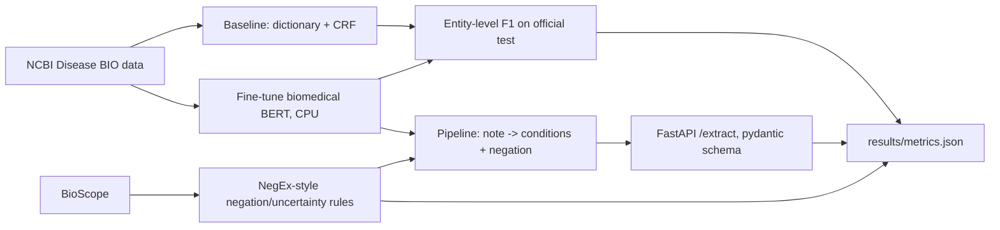

# Clinical NLP Extraction - Fine-Tuned Biomedical Transformer NER, Negation Handling, and a Structured-Extraction API

`clinical-nlp-extraction` · new project · estimated build effort: 5 h

## Problem

Claims and clinical review teams need to pull conditions out of free-text medical documents and know whether each one is affirmed or negated. This project fine-tunes a biomedical transformer for disease named-entity recognition on a public expert-annotated corpus, compares it with a dictionary-plus-CRF baseline on the official test split, adds rule-based negation and uncertainty detection (NegEx-style) evaluated on a public negation corpus, and serves the pipeline as a FastAPI endpoint that turns a note into schema-validated JSON (condition, span, negated, uncertain).

## Target jobs and skills

- **Steerbridge — Junior NLP Data Scientist** (`f71c55d0c0e1`): covers 93% of the JD's weighted top skills (NLP, Transformers, Machine Learning, Clinical Data, Python, Healthcare Data, Fine-tuning, Model Evaluation, Classification)

Skills/tools this project demonstrates: Python, NLP, Transformers, Fine-tuning, Hugging Face, PyTorch, Deep Learning, Machine Learning, Classification, Model Evaluation, Clinical Data, Healthcare Data, FastAPI

## Data

- **Dataset:** NCBI Disease corpus (793 PubMed abstracts, expert-annotated disease mentions) and the BioScope negation corpus (abstracts subset) — https://www.ncbi.nlm.nih.gov/CBBresearch/Dogan/DISEASE/
- **License/terms:** NCBI Disease corpus is a US Government work (public domain); BioScope is freely available for research
- **Size used:** 6,892 disease mentions in 793 abstracts (official train/dev/test split); BioScope abstracts ~1,270 documents
- **Plan:** Official NCBI train/dev/test split; model selection on dev only; the test split is scored once with entity-level (exact span) F1. Negation is evaluated on BioScope abstract sentences that contain a disease mention.

## Architecture

## Tech stack

Python 3.11, PyTorch (CPU), Hugging Face Transformers + datasets, seqeval, sklearn-crfsuite, FastAPI + pydantic, pytest

## Deliverables

- Baseline dictionary + CRF tagger and a fine-tuned biomedical transformer NER model (small enough to train on CPU in under an hour)
- NegEx-style negation and uncertainty detector with its own tests
- FastAPI /extract endpoint returning schema-validated JSON for a note, with request tests
- Error analysis of 50 test errors by category (boundary, missed, false positive)

## Success criteria (all must hold on a from-scratch `python run.py`)

| Metric | Threshold | How it is measured |
|---|---|---|
| Entity-level exact-span F1 on the NCBI Disease official test split | >= 0.80 | seqeval on test, scored once |
| Transformer vs. CRF baseline | transformer F1 >= CRF F1 + 0.05 | same test split |
| Negation detection F1 on BioScope disease sentences | >= 0.80 | negation module evaluation |
| API schema validity | 100% of 200 test notes return JSON that validates against the pydantic schema | pytest |
| Test coverage of src/ | >= 75% | pytest --cov |

## Evaluation artifacts (required; the evaluator recomputes metrics from these)

- results/test_predictions.jsonl, one line per test sentence with keys tokens, gold_tags, pred_tags (BIO), crf_tags (BIO)
- results/negation_predictions.csv with columns sentence_id, mention, gold_negated (0/1), pred_negated (0/1)
- results/api_check.json with keys n_notes, n_valid

## Baseline

Dictionary lookup plus a CRF tagger with hand-built features.

## Constraints

- Runs on Windows with `python run.py` from a fresh virtualenv; no make, shell scripts, paid APIs, or accounts.
- CPU-only by default (an optional `--device cuda` flag is fine); peak RAM <= 3 GB; total downloads <= 1.5 GB.
- PyTorch (if used) pinned to the CPU wheel via `--extra-index-url https://download.pytorch.org/whl/cpu`.
- Fixed random seeds; every reported number is written by code to results/metrics.json (never typed by hand).
- Test split is created once, saved, and never used for training, tuning, or threshold selection.
- Data download is scripted (Python requests), cached under data/, and verified by checksum or row count.
- Public corpora only (no MIMIC, no VA data); never claim clinical deployment or real patient records.
- CPU-only training; keep the model small enough for a laptop.

## Draft resume bullets (placeholders are filled only with reproduced metrics)

- Fine-tuned a biomedical transformer for disease NER on 793 expert-annotated abstracts, reaching [F1] entity-level F1 vs. [BASE_F1] for a CRF baseline
- Added NegEx-style negation and uncertainty detection ([NEG_F1] F1) and served extraction as a FastAPI endpoint with 100% schema-valid JSON
- Analyzed 50 test errors by boundary, miss and false-positive type to guide the next labeling pass
